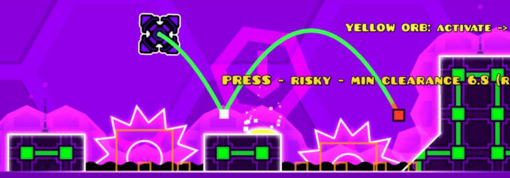

# AI-Geode

[](https://github.com/ooune/AI-Geode/actions/workflows/build.yml)
[](https://github.com/ooune/AI-Geode/releases/latest)
[](LICENSE)

**An AI player for Geometry Dash that plays levels by itself and learns from its own deaths.**

AI-Geode is a [Geode](https://geode-sdk.org) mod for **Geometry Dash 2.2081**. It is not a macro recorder, auto-clicker or replay bot. It reads the level and the player's state directly from the game, predicts where every possible input would take the player, and learns from its deaths which timings work.



> **Status: experimental.** In tests it has completed several main and online levels, taking from a handful of attempts to several hundred. Hard levels can take thousands of attempts, and some sections (jump pads, slopes, frame-perfect timings) are beyond it for now. See [Known issues](#known-issues).

---

## Contents

- [Features](#features)
- [How it works](#how-it-works)
- [Installation](#installation)
- [Usage](#usage)
- [Configuration](#configuration)
- [Known issues](#known-issues)
- [Roadmap](#roadmap)
- [Building from source](#building-from-source)
- [Development and releases](#development-and-releases)
- [Credits and licences](#credits-and-licences)

## Features

**Playing and learning**
- Plays classic (non-platformer) levels in every game mode: cube, ship, ball, UFO, wave, robot, spider and swing, in normal and mini size and with flipped gravity.
- Learns per level with reinforcement learning (a Q-table over game states) plus targeted timing experiments after each death (for example, jumped too early, too late, or held too long).
- Assigns blame for a death to the decision that caused it, so earlier mistakes are not repeated.
- Saves what it learns per level, so it continues where it left off. Memory can be exported, imported and reset.
- Optional practice-mode learning, with checkpoints placed by the AI.

**Trajectory prediction and safety**
- A physics model of every game mode, calibrated against the real game while it plays (gravity, jump strength, speed, input delay).
- Simulates press and release ahead of time and refuses inputs whose predicted path collides (the safety layer).
- Predicts yellow, pink, red, blue, green and black orbs and both dash orbs, learning their exact effect from the game, and decides whether to activate or skip each one. Spider, teleport and custom orbs are not simulated yet; paths through them are marked uncertain.
- Applies speed changes, gravity changes, and mode and size portals inside predictions. Paths whose model is not yet verified are marked uncertain.
- **Proximity awareness** (v0.7.0): measures, at every predicted step, how close the player's hitbox comes to anything deadly. The path is coloured from green to orange to red. Decisions prefer routes with more clearance, and near misses are remembered.

**Understanding whole levels**
- A map of every relevant object in the level, built at load time from the game's own collision rectangles.
- Analyses the level into obstacle groups, landing zones and difficult sections.
- Strategic planning: plans sequences of up to three jumps through upcoming obstacle groups, not just the next press.
- A cross-level strategy library: situations learned on one level (such as "spike row with 2-block landing space") are recognised and reused on new levels. Strategies that fail on the new level are rejected.

**On-screen information**
- A status panel: attempt, progress, game mode, decision source, predicted safety, clearance and near misses.
- Overlays for the predicted trajectory, orb paths and an alternative path, plus an optional "level understanding" debug view.
- A detailed log of every attempt in Geode's log: why it died, what it changed, prediction accuracy, orbs and proximity.

## How it works

Every physics step (240 per second), the mod:

1. **Observes** the player (position, velocity, mode, size, gravity, ground contact) and the nearby objects, straight from Geometry Dash's memory through Geode. There is no screen capture.
2. **Predicts** the trajectory of each candidate input (press now, wait, hold for *n* steps, a two-jump sequence…) with its calibrated physics model, against the real collision rectangles of nearby hazards and blocks.
3. **Decides:** the learned policy proposes an input. The planner looks for safer or better timings. The safety layer overrides any input whose predicted path collides when a safe one exists. Among safe options it prefers more clearance.
4. **Learns:** after each attempt it updates its value table, analyses the death, and schedules a timing experiment for the next attempt at that spot. It also records which strategies passed which obstacle groups, for use on other levels.

The learning core (`core/`) is plain C++ with no Geode dependency. It is covered by a simulator-based test suite (128 tests) that runs on every push.

For the full technical description, measurements and per-version validation, see **[docs/TECHNICAL.md](docs/TECHNICAL.md)** and **[docs/validation/](docs/validation/)**.

## Installation

Requirements: **Geometry Dash 2.2081** on **Windows**, with **[Geode](https://geode-sdk.org) 5.11.1 or newer** installed. The mod also uses the `geode.node-ids` mod, which Geode installs automatically.

1. Download `aqvose.ai-geode.geode` from the **[latest release](https://github.com/ooune/AI-Geode/releases/latest)**.
2. Put the file into your Geode mods folder: `Geometry Dash/geode/mods/`. In Geode you can open this folder with the folder button on the mod list.
3. Restart Geometry Dash. **AI Geode** appears in Geode's mod list.

To update, replace the file with the newer one and restart. Your AI's learned memory is kept. To uninstall, delete the file. The memory stays in the mod's save folder (`%LOCALAPPDATA%\GeometryDash\geode\mods\aqvose.ai-geode`; the AI popup's **Open Folder** button opens it) until you remove it.

Each release also lists the file's SHA-256 checksum (`SHA256SUMS.txt`).

## Usage

1. Open any classic level.
2. Press **F8** (rebindable), or open the pause menu and click the green **AI** button, then switch the **AI Player** toggle on.
3. The AI plays, dies, learns and retries by itself (with **Auto Retry** on). The status panel at the top left shows what it is doing.
4. Press **F8** again to take control back at once. While the AI is on, your own jump inputs in that level are ignored, so the two never fight over the button.

The pause-menu **AI** popup has three tabs:
- **Play:** turn the AI, prediction, strategic planning, learning, auto retry and practice mode on or off, and set the learning speed.
- **Display:** status panel, extra details, level map, trajectory, orb paths and the alternative path.
- **Memory:** export, import or reset this level's memory or the shared cross-level knowledge, and open the memory folder.

**Note:** levels the AI completes in normal mode count as completions for your account, just as if you had played them. Turn on **Practice Mode Learning** if you only want it to practise.

## Configuration

All settings are in the mod's Geode settings page (Geode → AI Geode → settings), and most of them are also in the in-game AI popup.

| Setting | Default | What it does |
|---|---|---|
| AI Player | off | Lets the AI play. Toggle with **F8**. |
| Learning | on | Updates the AI's memory after each attempt. Turn it off to just watch it play what it knows. |
| Learning Speed | 0.5 | How strongly each attempt changes what it learned. |
| Auto Retry / Respawn Delay | on / 0.5 s | Restarts automatically after a death. |
| Practice Mode Learning | off | Plays in practice mode with checkpoints placed by the AI. |
| Training Speed | 1.0 | Game speed while the AI plays. Above 1 trains faster, and the music then goes out of sync. |
| Use Prediction | on | Uses the trajectory predictor and safety layer. |
| Strategic Planning | on | Plans multi-jump sequences through upcoming obstacle groups. |
| Prediction Horizon | 0.75 s | How far ahead each prediction looks. |
| Show Trajectory / Orb Trajectories / Alternative Path | on / on / off | Path overlays. |
| Danger Colours | on | Colours the path by clearance (green, orange, red; yellow means uncertain). |
| Clearance in Decisions | on | Prefers timings with more clearance. Off restores the pre-v0.7.0 scoring. |
| Safe Clearance / Danger Clearance | 18 / 4 units | Clearance thresholds for green and red (a block is 30 units). |
| Show Level Understanding (and its layers) | off | Debug view of the level map, groups, landing zones and plans. |
| Show Status Panel / Show Debug Data | on / off | The on-screen panel and its extra details. |

## Known issues

- **Jump pads and slopes are not simulated.** Paths that touch them are marked uncertain (yellow). Levels that rely on pads (for example the start of *Hexagon Force* and parts of *Cycles*) can stall the AI at that spot.
- **Hitbox sizes are estimates** for some modes (ship, wave, mini). Round hazards (saws) and rotated hazards are approximated by their bounding rectangles. Improving this is the current work, see the roadmap.
- **Platformer levels are not supported**: they need left/right input, so the AI turns itself off there and says why. In **2-player levels** only player 1 is controlled.
- **Hard levels take many attempts.** Frame-perfect sections and tight wave corridors may never be beaten.
- **Objects moved by triggers** are tracked at their current position only. Their future movement is not predicted.
- Some mode-specific button rules (for example exactly when a robot's boost ends) are assumptions that are still being verified in game.
- **Windows only** for now. The mod has only been built and tested on Windows.

The full list, with measurements, is in [docs/TECHNICAL.md → Known limitations](docs/TECHNICAL.md#known-limitations).

## Roadmap

| Version | Focus | State |
|---|---|---|
| v0.1 – v0.3 | Learning core, trajectory prediction for all modes, safety layer, real step counting | Done |
| v0.4 | Cross-level learning (strategy library) | Done |
| v0.5 | Whole-level map, level analysis, strategic sequence planning | Done |
| v0.6 | Orbs and dash orbs, mode-specific precision, new UI | Done |
| **v0.7** | **Trajectory proximity: clearance-aware decisions, danger colours, near-miss learning** | **Released** |
| v0.8 | **Hitbox accuracy:** real player hitboxes read from the game, round and rotated hazards, collision validation against real deaths | In progress |
| next | Jump pads and slopes in the predictor, trigger-moved objects, more modes in strategic planning | Planned |

The detailed plan is in [docs/ROADMAP.md](docs/ROADMAP.md), and every version's changes are in [changelog.md](changelog.md).

## Building from source

You only need this to change the mod. Players should download a [release](https://github.com/ooune/AI-Geode/releases).

Mod (Windows):
1. Install the [Geode SDK and CLI](https://docs.geode-sdk.org/getting-started/), version 5.11.1, and set the `GEODE_SDK` environment variable.
2. Configure and build:
   ```bash
   cmake -B build -DCMAKE_BUILD_TYPE=Release
   cmake --build build --config Release
   ```
   The packaged mod is `build/aqvose.ai-geode.geode`. Geode's CMake setup also installs it into your game folder when it can find it.

Learning core and tests (any OS, no Geode or game needed):
```bash
cmake -S tests -B build-tests -DCMAKE_BUILD_TYPE=Release
cmake --build build-tests
./build-tests/aigd_tests            # add --bench for the learning benchmark
```

Repository layout:

| Path | Contents |
|---|---|
| `core/` | Game-independent AI: physics model, predictor, agent, learning, level analysis, strategy library, overlays |
| `src/` | The Geode mod: game observer, hooks, input control, UI, overlays |
| `tests/` | Simulator of GD-like levels and the test suite |
| `docs/` | Technical documentation, validation reports, roadmap, release notes |
| `mod.json`, `about.md`, `changelog.md`, `resources/` | Geode mod metadata |

## Development and releases

- `main` holds released and release-ready code. Larger work happens on `feat/…` branches.
- Every push and pull request that touches the code runs the **[Build workflow](.github/workflows/build.yml)**:
  1. builds the mod on Windows with the Geode SDK version from `mod.json`;
  2. runs the core test suite;
  3. uploads the packaged `.geode` file as a workflow artifact.
- **Releases are created automatically from version tags.** Pushing a tag such as `v0.7.0` runs the same build and tests, then checks that the tag matches the version in `mod.json` and that release notes exist in `docs/releases/<tag>.md`. Only then does it publish the GitHub release *AI-Geode v0.7.0* with the built `.geode` file and its checksum. If any step fails, nothing is published.
- Tags with a suffix (for example `v0.8.0-beta.1`) are published as **pre-releases**, for builds that are not yet fully tested in game.

To make a release: update `version` in `mod.json`, add `docs/releases/vX.Y.Z.md` and a `changelog.md` entry, then commit, tag `vX.Y.Z` and push the tag.

## Credits and licences

- AI-Geode is released under the **[MIT License](LICENSE)**.
- Built on the **[Geode SDK](https://github.com/geode-sdk/geode)** (Boost Software License 1.0) and its Geometry Dash bindings. Uses the **[node-ids](https://github.com/geode-sdk/node-ids)** mod (Boost Software License 1.0) at runtime. The `fmt` library (MIT) comes with Geode.
- **Geometry Dash** is made by RobTop Games. This project is not affiliated with or endorsed by RobTop Games or the Geode team.
- **QOLMod** by TheSillyDoggo was studied for how it *displays* hitboxes and trajectories (which of the game's own collision data it reads). Its licence does not allow reuse of its code, so **no QOLMod code is included**. AI-Geode's collision handling is written independently from the Geode bindings and checked against the game's own behaviour.
- No other third-party code is included in this repository.
